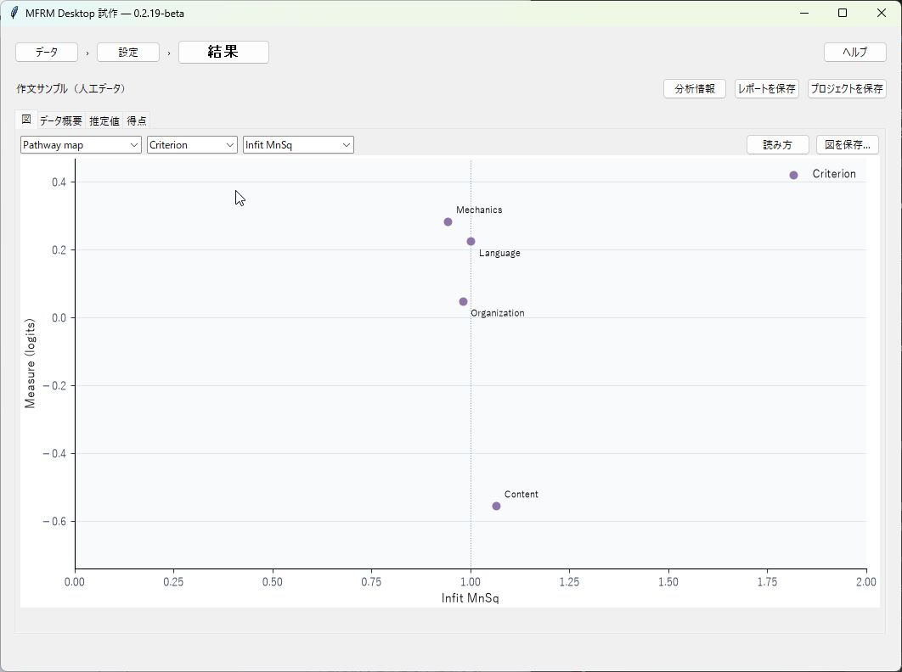

# MFRM — 多相ラッシュモデル分析アプリ

作文や実技などの評定データから、対象者の測定値、評価者の厳しさ、課題・評価観点の難しさを分析するPythonアプリです。図と表で結果を確認し、レポートを保存できます。

操作を試せる人工データのサンプルを用意しています。自分のデータを準備する前に、サンプルで分析の流れを確認してください。

## 利用を始める

| 利用方法 | 入口・使い方 |
|---|---|
| ブラウザーで使う | [Web版を開く](https://mfrmpythonapplication-xodghmcghngx8cz5zmhfeg.streamlit.app) · [作文サンプルで結果を読む](docs/apa_manuscript_template.md#writing-assessment-first-report) |
| Windowsのデスクトップで使う | [デスクトップ版の使い方](docs/desktop_user_guide.ja.md)：入手・起動、サンプル、CSV、図表、保存、警告への対応 |
| 自分のパソコンでWeb版を動かす | [インストール](README.md#install)・[起動の手順（英語）](README.md#run) |

**現在はベータ版です。** デスクトップ版の実行ファイル（EXE）は、2026年10月29日時点では[GitHub Releases](https://github.com/Ryuya-dot-com/MFRM_Python_Application/releases)で一般配布されていません。Windows用の検証候補はPython同梱のZIPとして用意しています。候補の入手・起動は[配布手順](docs/desktop_windows_installation.md)を参照してください。ソースコードからの起動手順も上のガイドにあります。

デスクトップ版はRSM／PCMをJMLEまたは固定母集団SDのMMLで推定し、バイアス分析、指定区間・共同交互作用、G/D Studyを同じアプリで利用できます。初回からこれらを含む配布を目指しています。FACETSやConQuestを別途インストールする必要はありません。分析ごとの適用条件と推論の保留は出力に表示します。

## デスクトップ版でできること

- CSVの評定データを読み込み、対象者・評価者・課題などの列を指定して分析する。
- Wright map、Pathway map、得点カテゴリーの確率曲線と、推定値・適合度などの表を表示する。
- バイアス対、指定した水準・差の区間、共同交互作用を設定し、対象ごとの表と図を確認する。
- 完全均衡の1～2ランダム要因設計でG/D Studyを行い、評定者数・課題数の計画を比較する。
- 英語／日本語、説明付き／論文掲載用の図を切り替える。
- 入力データと結果をプロジェクトに保存し、後で再推定せず開き直す。
- 図表入りHTML、注記付きCSV、PNG／SVGと図注テキストを保存する。

表示例は人工データです。実在の学習者・評価者の結果ではありません。

## 結果を読むときに

最初に、分析に使われた行数、採点基準の範囲、画面の警告を確認してください。「推論は保留です」と表示された場合は、図が表示されても、その結果から差や順位を結論づけないでください。[警告への対応](docs/desktop_user_guide.ja.md#困ったとき)で確認事項を説明しています。

このアプリは研究・教育や分析の検討を支援します。異なるソフトウェアでは推定法や統計量の定義が異なるため、FACETSやConQuestの結果とすべて同じになることを保証するものではありません。

## 利用条件・引用・問い合わせ

[MITライセンス](LICENSE)で公開しています。研究・教育・業務・商用に利用できます。再配布時は著作権とライセンスの表示を保持してください。

研究で利用した場合は、実際に使ったバージョンを記録してください。[引用情報](CITATION.cff)と[引用方法（英語）](README.md#citing-this-software)を用意しています。

不具合や質問は[GitHub Issues](https://github.com/Ryuya-dot-com/MFRM_Python_Application/issues)へお寄せください。OS、アプリのバージョン、操作手順、表示されたメッセージがあると確認しやすくなります。データを添える場合は、個人を特定できる情報を除いてください。

[English README](README.md)
