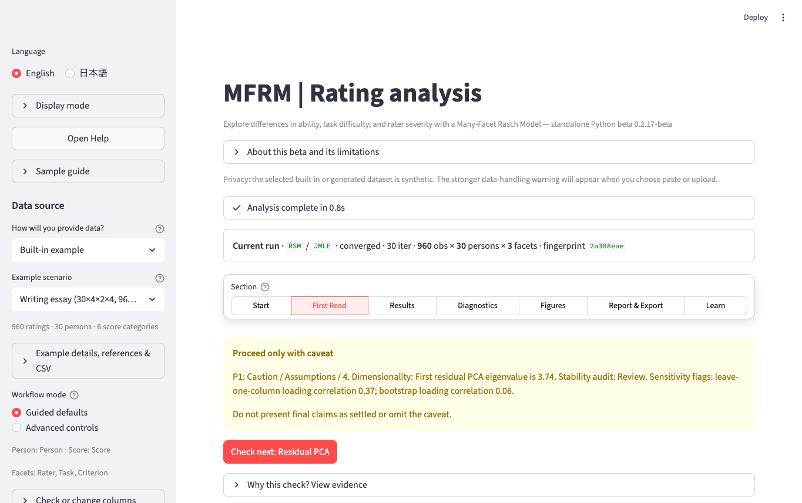

# MFRM Streamlit

**0.2.19-beta** — 2026-10-28.
It carries analysis holds consistently into reports and saved results,
preserves restorable history across input changes, and provides qualified
pointwise intervals for selected fixed-SD RSM/PCM structural effects and differences.
Check **About MFRM / アプリ情報** for the hosted version and source commit.
The release record distinguishes source publication from hosted acceptance.
The [development integration ledger](docs/development_integration.md) records
the remaining integration work and statistical qualification limits.

Public app: https://mfrmpythonapplication-xodghmcghngx8cz5zmhfeg.streamlit.app

[MIT License](LICENSE) · [How to cite](#citing-this-software)

Standalone Python beta application for Many-Facet Rasch Model estimation in Streamlit.

This app estimates, diagnoses, stress-tests, and reports MFRM analyses in
Python. Other software may be cited as methodological history, but it is not
called, imported, handed a job, or used as a public release gate.

## Status

- Checkout status: public beta source (**v0.2.19-beta**)
- Runtime engine: standalone Python
- Primary entrypoint: `streamlit_app.py`
- Intended use: exploratory analysis, teaching, reporting support, and research workflow prototyping
- Not intended as: a validated drop-in replacement for FACETS, TAM, sirt, mirt, or `mfrmr`

The candidate's [required Linux/Python 3.11 and 3.12 CI passed](https://github.com/Ryuya-dot-com/MFRM_Python_Application/actions/runs/40687727467)
at source commit `f5139bb7ec02fbfa2f1079ef6e381acff468d683`.
Local browser acceptance and later documentation preparation do not establish
deployment acceptance. See [publication and recovery](DEPLOYMENT.md#publication-and-hosted-acceptance)
for the remaining hosted checks.

Start with a built-in example and follow the interpretation checks before
using results in a report. Numerical convergence does not, by itself, establish
identification, finite estimates or valid statistical inference.

General MML tables, Person-score inference, estimated population SD and automatic
equivalence conclusions retain their current holds. For supported unit-weight,
fixed-SD RSM/PCM fits, the **Specified Structural Intervals** output provides
pointwise asymptotic normal intervals for one facet's levels and a prespecified
difference when its numerical checks pass. It uses full structural covariance;
finite-sample coverage remains unqualified. See the
[scope, assumptions and checks](docs/mml_quadrature_cross_engine_review.md#fixed-sd-interval-route-20261028).
Optimizer termination and technical estimates are retained; reopened results
are checked against the current output-specific qualifications.
Failed or invalid EM M-steps stop at the last accepted point with a recorded reason.
See the [TAM comparison and implementation assessment](docs/mml_quadrature_cross_engine_review.md#tam-strategy-20261023)
for the verified scope and the recommendation to retain Python with independent numerical checks.

Research implementation notes and older verification claims have moved to the
[historical research record](CHANGELOG.md#research-status-record-moved-from-readme-2026-10-14).
Those dated records describe their original checkout; they do not certify this
checkout or the hosted app. Current development priorities live in [ROADMAP](ROADMAP.md).

## Which documentation to use

| Need | Current reference |
|---|---|
| Install, analyze, and understand supported features | This README and the in-app Help |
| Configure anchors | The bundled [anchor guide](anchor_templates_and_guideline/anchor_user_guidelines.md), also shown in Advanced controls |
| Prepare a manuscript | The [manuscript guide](docs/apa_manuscript_template.md) |
| Find controls in the revised layout | The [UI revision](docs/ux_adversarial_audit.md#layout-copy-rewrite-20261023): grouped input and save controls, optional detail, and preserved warnings. Version, limits, license and citation are in **About MFRM / アプリ情報** in the sidebar. |
| Start with a short report and format its tables | [Basic/detailed output and APA table Notes](docs/apa_manuscript_template.md#report-tables-and-notes) (Japanese) |
| Choose the first tables and figures for the writing-assessment sample | The [Japanese worked guide](docs/apa_manuscript_template.md#writing-assessment-first-report): three tables, two figures, and interpretation holds |
| Obtain selected fixed-SD structural intervals or inspect quadrature sensitivity | The [Japanese](docs/fixed_sd_quadrature_check.ja.md) or [English](docs/fixed_sd_quadrature_check.en.md) guide |
| Understand TAM/Python algorithm differences and their implications for decisions | The [algorithm and interpretation review](docs/mml_quadrature_cross_engine_review.md#tam-algorithm-decision-20261023) (Japanese): optimization, scoring, uncertainty, diagnostics and bounded numerical examples |
| Check whether internal computation can reverse a threshold decision | The [decision-boundary review](docs/mml_quadrature_cross_engine_review.md#tam-boundary-decision-20261023) (Japanese): discrete posterior quantiles, continuous CDF controls, recalibration and parameter boundaries |
| Assess continuous posterior scoring as a boundary remedy | The [CDF follow-up](docs/mml_quadrature_cross_engine_review.md#posterior-cdf-followup-20261023) (Japanese): interpolation failures, narrow posteriors, independent integration controls and decision-rule definitions |
| Interpret SEs and intervals across Python and TAM | The [SE/CI review](docs/mml_quadrature_cross_engine_review.md#se-ci-review-20261023) and [PCM information follow-up](docs/mml_quadrature_cross_engine_review.md#pcm-information-review-20261023) (Japanese): uncertainty definitions, calibration, contrasts, coverage, and quadrature errors in SE/covariance |
| Compare different origins, constraints and signs | The [parameterization review](docs/mml_quadrature_cross_engine_review.md#parameterization-review-20261023) (Japanese): equivalent contrasts, full covariance, reference values and population-origin changes |
| Interpret equivalence and multiple comparisons | The [decision review](docs/mml_quadrature_cross_engine_review.md#decision-claim-review-20261023) (Japanese): nonsignificance, equivalence margins, simultaneous intervals and ranking. Automatic facet-equivalence conclusions are withheld for all estimation methods, including reopened results. |
| Read held SEs, intervals and shrinkage outputs | The [output review](docs/mml_quadrature_cross_engine_review.md#uncertainty-output-review-20261023) (Japanese): step/measure tables and saved results retain current holds; EB plots show technical points without confidence bars. A zero plug-in shrinkage SD is not evidence of equality. APA and scoring guidance must follow the same qualification. |
| Inspect the authorized small simulation and its limits | The [multiview pilot](docs/mml_quadrature_cross_engine_review.md#multiview-small-sim-20261023) (Japanese): 48 datasets, 96 Python fits, four TAM comparisons, and separate normal-model shrinkage controls. Native stopping success did not meet the prespecified gradient screen, so MFRM coverage and decision rates are not reported. Forest plots and reliability exports now preserve current qualification. |
| Change or release the application | [CONTRIBUTING](CONTRIBUTING.md), [DEPLOYMENT](DEPLOYMENT.md), and the current sections of [RELEASE_CHECKLIST](RELEASE_CHECKLIST.md) |
| Decide priorities and validation scope | The [current release milestones](RELEASE_CHECKLIST.md#release-milestones-20261028) and [execution plan](ROADMAP.md#release-focus-20261028); older dated plans are retained as history |
| Review planned learning examples and reporting coverage | The [milestone checklist](ROADMAP.md#learning-reporting-milestones) and [reporting requirements](docs/mfrm_reporting_requirements.md) (Japanese); piano and skating examples are planned |

The [initial release plan](MFRM_STREAMLIT_RELEASE_PLAN.md),
[v0.2.0 plan](docs/v0.2.0_beta_plan.md), and
[old advanced-model guide](docs/advanced_models_guide.md) preserve earlier
workflows. Their checked tasks and feature descriptions do not establish
current availability or authorize publication actions.

Dated research and integration records apply to their stated source versions,
inputs, and methods. Some links point to local-only evidence under
`validation/generated/`, `validation/source_snapshots/`, or retained study
directories; those files are not supplied by a fresh Git checkout. An available
document or a passing old test is not verification of the current analysis.
Foundational references remain useful for the formulas they support; neither
their age nor a newer software manual establishes this implementation's accuracy.

## Install

Use Python 3.11 or 3.12 (the versions covered by CI) and a virtual environment. On Windows, use
`.venv\Scripts\Activate.ps1` instead of the `source` command below:

```bash
git clone https://github.com/Ryuya-dot-com/MFRM_Python_Application.git
cd MFRM_Python_Application
python3 -m venv .venv
source .venv/bin/activate
python -m pip install --upgrade pip
python -m pip install -r requirements.txt
```

For local verification and CI-equivalent smoke tests, install the development dependencies:

```bash
python -m pip install -r requirements-dev.txt
```

## Run

```bash
python -m streamlit run streamlit_app.py
```

For a first local smoke check, choose **Continue without the guide**, keep
**Built-in example** and the **Writing essay** scenario, then click
**Run this analysis** with the guided defaults. Results open in **First Read**;
follow **Check next** to the recommended diagnostic. Use **Report & Export**
when you need a report or result files.

Other built-in datasets are available under **Example scenario**, including
*Large-scale writing*, *L2 speaking*, *Clinical OSCE*, and *Reading testlet —
binary*. The sidebar's **Example details, references & CSV** disclosure holds
the design description, references, and sample download. The actual column
mapping remains visible as a short summary; open **Check or change columns**
to edit it. For pasted or uploaded data, the mapping editor starts open.

For a linking lesson, choose **Two schools, common recordings (360 ratings)**.
The bilingual lesson above the input preview follows 40 students and 10 shared
reference recordings through joint calibration, interpretation and reporting.
It explains when fixed anchors are a separate next step and why anchor counts
or agreement with fixed values do not establish reference stability. See the
[worked example](anchor_templates_and_guideline/anchor_user_guidelines.md#two-school-recordings).

Choose **Generate synthetic data** from **How will you provide data?**.
Use it to create public long-format MFRM simulation data by setting the number
of facets, each facet's level count and spread, the score-category support,
zero-count categories, threshold spacing, missingness, and seed values. The
generated view includes reactive score-histogram, Wright-preview, and
pathway-preview plots, plus a generated CSV download.

The generator samples from an RSM-style many-facet adjacent-category model:
`log(P_k/P_{k-1}) = eta - tau_k`, where
`eta = person measure - sum(facet effects)`. This is the Andrich (1978)
rating-scale form extended to many-facet main effects in the sense of Linacre
(1989). The normal draws for effects, rotating first-facet assignment, row
deletion for missingness, and zero-count category recoding are simulation
conveniences for demonstrations and stress tests, not empirical defaults from
those sources. Row deletion is uniform MCAR deletion. Observation noise and
zero-count recoding deliberately depart from the pure RSM-style data-generating
model; the reported truth thresholds describe the pre-recoding sampling model.

For deployment notes, including Streamlit Community Cloud settings and privacy gates for hosted use, see `DEPLOYMENT.md`.

## Active Checkout

The current public-deployment line for the latest UI, help, FACETS-style
yardstick, and reproducibility refinements is `main`. The earlier
`slope-aware-bias-inference` development branch has been merged into `main`.

If you keep more than one local checkout of this repository, verify the one you
are running before starting Streamlit:

```bash
git status --short --branch
git branch --show-current
git rev-parse --show-toplevel
```

The app should be launched from the repository root that contains the updated
`streamlit_app.py`, `locales/en.json`, and `locales/ja.json`. Seeing the old
"Try another scenario" sidebar buttons or the old "Show yardstick labels
directly on plot" control means the process is running an older checkout or the
wrong commit, not the current `main`.

Open **About MFRM / アプリ情報** in the sidebar to inspect the source
commit when it is available. Compare it with `git rev-parse --short HEAD` to
identify the running checkout; a version label alone does not identify a commit.

## Preview



The screenshot uses the built-in synthetic sample data and shows the
post-estimation workspace after the optional sample guide. On a new session,
the application first offers three routes: learn with the sample, start with
your own data, or continue without the guide. Raw response rows remain behind
a collapsed preview instead of being exposed by default. In Guided defaults,
the primary **Run this analysis / この設定で分析する** action now follows the
column mapping and readiness checks in the main workspace; the sidebar no
longer duplicates a technical `FACETS-mode` Run action. Advanced controls keep
the established sidebar route for expert workflows. The data source is also
grouped into four user tasks—built-in example, generate, paste, or upload.
Choosing an example keeps its scenario selector visible directly below.
Input errors disable Run in both modes; correct the selected columns or flagged
values to continue. Small counts, missingness and unusual score patterns prompt
review without automatically preventing a run. Counts do not establish precision;
after fitting, retain the interpretation holds and review the diagnostics.
Guided defaults also limits setup to first-run decisions: column roles, model,
estimation method, and analysis coverage. Weighting, anchors, optimizer and
identification controls, regularization, population models, score-scale
overrides, report scaling, and visualization styling remain available after
switching to Advanced controls. Returning to Guided restores documented
standard values instead of retaining an invisible advanced customization.

The current cross-cutting UX baseline and the planned workflow-shell work are
documented in [`docs/ux_adversarial_audit.md`](docs/ux_adversarial_audit.md).
The pre-browser accessibility gate is defined in
[`docs/browser_accessibility_acceptance.md`](docs/browser_accessibility_acceptance.md).
It generates 52 English/Japanese task cases and 482 required evidence rows;
templates, CSS inspection, and AppTest correctly remain `NOT_ACCEPTED` until
all version-matched browser records pass with retained evidence.

## Data Privacy

Rating data can contain person IDs, rater IDs, school or institution identifiers, subgroup labels, and other sensitive information.

For confidential data, run the app locally on a controlled machine:

```bash
python -m streamlit run streamlit_app.py
```

If the app is deployed to Streamlit Community Cloud or another hosted platform, uploaded data may be processed on remote infrastructure. Confirm your institutional data-handling requirements before upload. Prefer removing direct identifiers, limiting uploaded columns to analysis variables, and avoiding hosted deployments for regulated or confidential datasets.

The app is intended to keep uploaded data in memory during the session unless the user explicitly downloads or exports outputs.

## Verify

```bash
python -m py_compile streamlit_app.py
python streamlit_app.py --doctor
python streamlit_app.py --release-check
python streamlit_app.py --self-test
make apptest
python streamlit_app.py --benchmark-quick --benchmark-csv validation/generated/benchmark_smoke.csv
python streamlit_app.py --export-demo-report validation/generated/demo_report
```

For public distribution, run at least `--doctor`, `--release-check`, and
`--self-test` from a fresh checkout before tagging or deploying. `--doctor`
confirms Python/package floors, bundled assets, the standalone runtime boundary,
and the privacy/cache boundary. `--self-test` exercises the app's built-in
statistical and export contracts. The export command above generates a
sanitized, Python-native demo-report package without uploading private data.
The legacy parity-fixture generator and frozen fixtures are compatibility-only
maintenance code. They have no CLI or Make target, are not called by
`--self-test`, and tests marked `legacy_compat` are excluded from `make
apptest`, `make verify`, and GitHub CI. They are outside the standalone release
gate.

Optional Make shortcuts:

```bash
make verify
make clean
make run
```

`make clean` removes development caches only. It preserves validation evidence,
source snapshots, backups, and virtual environments. In a Dropbox workspace,
wait for synchronization to finish before bulk cleanup; `.gitignore` does not
control Dropbox synchronization.

## Data Format

Use long-format rating data. The interactive upload path accepts CSV, TSV, TXT,
Excel `.xlsx` / `.xlsm` (first worksheet), Apache Parquet, and JSON / JSON-lines.
Pasted spreadsheet text supports comma, tab, or semicolon delimiters.

```csv
Person,Rater,Task,Criterion,Score
P01,R1,T1,C1,4
P01,R2,T1,C1,5
P02,R1,T2,C2,2
P02,R2,T2,C2,3
```

Required:

- Person column
- Score column with ordered integer categories
- At least two non-person facet columns such as rater, task, criterion, prompt, form, or occasion

Supported score handling includes:

- Intended rating boundaries, such as 1 to 5
- Zero-count intermediate categories, such as a 1-5 scale where category 3 is absent
- Optional recoding of non-consecutive observed categories
- Rejection of fractional categories with a clear error

### Paste From a Spreadsheet

Teachers and workshop users can paste directly from Excel, Google Sheets, or a
gradebook export. Keep the first row as column names, then select the cells and
copy/paste them into **Data source → Paste CSV/TSV text** in the sidebar.

```csv
Student,Rater,Assignment,Criterion,Score
S01,TeacherA,Essay1,Content,4
S01,TeacherA,Essay1,Organization,3
S01,TeacherB,Essay1,Content,5
S02,TeacherA,Essay1,Content,2
```

When mapping columns in the app, choose `Student` as **Person**, `Score` as
**Score**, and use `Rater`, `Assignment`, and `Criterion` as facets. Do not paste
total scores if rubric-level ratings are available; one row should represent one
rating event.

## Model Scope

Implemented in the standalone Python engine:

- RSM
- PCM
- bounded GPCM
- JMLE
- MML via EM, Direct, Hybrid, and Auto engine selection
- latent regression via constrained `population_formula`
- fixed user-set population prior SD by default, with opt-in EM population-SD
  estimation in Advanced controls; free-SD inference and SE/CI remain withheld
- on-demand MML prior-SD sensitivity refits with fit, measure-shift, rank, and
  latent-regression coefficient diagnostics, plus prespecified AnalysisID,
  SensitivityPlan, variant-record, and SensitivityDecision lineage
- MML observed-information covariance for non-person facet SE/CI when the
  fitted parameter vector is small enough for routine diagnostics
- MML covariance audit exports with Hessian rank, condition number,
  eigenvalue regularization, fallback/skip status, claim status, and the S0
  output-qualification reason code
- EAP posterior scoring
- plausible values
- strict marginal diagnostics
- residual PCA diagnostics
- residual PCA stability audit for sparse or weakly overlapped residual matrices,
  leave-one-column-out EV1/loading sensitivity, and row-bootstrap EV1/loading
  stability
- bias / local interaction screening with DFF-style sparse-cell, Holm, BH/FDR,
  and practical-logit review flags
- bias-inference audit exports that label conditionality, multiplicity family,
  sparse cells, profile-CI status, and connected-scale caveats
- versioned `output_qualification.csv` gates that keep unqualified information
  criteria, automatic model recommendations, LR decisions, structural
  covariance claims, and pairwise bias measures out of public conclusions while
  retaining explicitly marked technical values for audit
- exact identified step and GPCM log-slope optimizer coordinates, with a
  `parameterization_audit.csv` that preserves expanded public estimates while
  recording free dimensions, constraint residuals, coordinate rank, and slope
  bounds
- anchor audit and linking review
- anchor drift and equating-chain summaries
- anchor/equating workflow checklist for current-run linking evidence
- prediction for fitted, held-out, and scenario rows
- simulation and design evaluation
- final-report readiness checklist with legacy display columns and a canonical
  EvidenceRecord ledger that separates computation state from conclusion
  stability
- visual interpretation checklist for guided figure reading
- visual evidence binder with figure files, caption drafts, and figure-to-claim mapping
- visualization preferences for theme, label density, font size, dimensions, and caption detail
- claim-to-evidence matrix for manuscript and reviewer-response planning
- method-reference audit that maps model, estimation, fit, dimensionality, bias, simulation, and external-validation claims to APA/Zotero-aligned references
- latent-regression covariate type preview for numeric IDs/codes that may need categorical coding
- downloadable tables, configuration, scripts, method appendix, manuscript handoff, and manuscript binder
- reproducibility/config fingerprints for analysis exports

## Guided Reporting Workflow

To begin an article, open **Report & Export → Start a paper**. Download the
English APA Word template, fill in the study-specific prompts, and consult the
optional Results draft with its evidence checks. See the
[manuscript guide and reusable template](docs/apa_manuscript_template.md).

Basic Word/PDF/HTML reports now include observed rating design and category-use
tables when retained input rows are available. They separate actual rating counts
from likelihood weights, show rater overlap, and preserve zero-count categories.
Methods and Results drafts use recorded settings and current inference holds,
including reopened analyses and unsuccessful or unrecorded optimizer termination.
The same current termination rule applies to technical CSV qualification, live
interval plots, reliability and scoring-quality prose. Saved Ready labels do not
override failed, absent or non-Boolean termination evidence. Technical numeric
values remain available with their hold reason; they are not permission to infer.
The [assumption and boundary follow-up](docs/mml_quadrature_cross_engine_review.md#robustness-boundary-review-20261023)
examines ability-related assignment, shared-task variation and unrounded decision
boundaries separately from numerical agreement with TAM.

The G-study / D-study panel uses retained preprocessed scores in a separate
balanced crossed ANOVA. It supports one or two non-object random facets, at
least two levels per factor, one observation per cell and unit observation
weights. Missing/repeated cells and unsupported designs produce an explanation.
Signed variance estimates remain visible beside the zero-clipped values used
for G/Phi, and the observed design remains in the forecast table. Its CSV
includes calculation conditions, input identity and limitations. G/Phi intervals
are withheld because the existing person-only bootstrap has not established
coverage for the random-facet targets. G/Phi values alone do not establish a
universal threshold for an acceptable assessment or validate a planned design.

For a first analysis, use this short path:

1. Open **First Read** after fitting. Read the main result and any limits on its
   interpretation. A completed calculation does not by itself establish that
   an estimate or interval can support a conclusion.
2. Open the result or diagnostic relevant to your question. Use the reading
   guidance beside the table or figure; you do not need to visit every panel.
3. Open **Report & Export → Create a report** to read and save a basic report.
   Use **Save tables & figures**, **Start a paper**, or **Review checks** when
   the research question or a stated limitation calls for them.

The advanced reporting view uses one content selector. It displays only the
chosen report and keeps that choice when changing language or leaving and
returning to the view. It does not run a new MFRM fit for these display actions.

**Tables** shows the current result tables and APA formatting controls.
Open **Review checks → Supporting material → Additional analyses (optional)**
for model comparison, G/D planning, rating-network checks, fixed-SD MML numerical
checks or parameter-recovery simulation. The advanced content selector provides
the same entry. Choose one question; the other tools are not rendered or run.
G/D point calculations run when selected. Other new calculations require their
Run button. Simulation settings and cached results survive leaving the view;
simulations generate new data and do not analyze the uploaded observations.
Current qualification and interpretation holds continue to apply. This entry
still follows a fitted analysis; a standalone G/D input workflow is not yet
implemented.

<details>
<summary>Additional checks and writing resources — choose those relevant to your analysis</summary>

The following resources explain specific results and limitations. They are not
23 required steps, and optional resources do not override any inference hold.

- Output qualification: open `output_qualification.csv`; a
   `PublicConclusionAllowed = False` row overrides any raw numeric value shown
   elsewhere in the bundle.
- Parameterization: open `parameterization_audit.csv`; require `PASS`, zero
   artificial coordinate null directions, and satisfied expanded GPCM bounds.
- Numerical checks: distinguish optimizer stopping from stationarity and
   quadrature accuracy; a successful stopping flag does not establish valid inference.
- SE/CI basis: review `SE_Method`, `SE_Status`, `CI_Method`, and
   `CI_Status`; for MML also review `mml_covariance_audit.csv` before
   using observed-information intervals in prose.
- Category functioning: check sparse categories, monotonic average measures, and threshold order.
- Reliability / separation: confirm whether the design supports stable person and facet ordering.
- Wright map targeting: check whether person locations and facet difficulty/severity ranges overlap.
- Fit diagnostics: review large standardized residuals and misfitting elements.
- Bias / local interaction: use `bias_inference_audit.csv` with the DFF tables; treat flags as review prompts, not automatic proof of bias.
- PCA / dimensionality: check both the residual PCA result and `pca_stability_audit.csv`, including missingness, pairwise overlap, leave-one-column-out, and bootstrap stability.
- MML population SD: state whether it was fixed or estimated. For fixed SD, use the prior-SD sensitivity screen or justify the chosen scale. For estimated SD, retain the free-SD inference hold; numerical convergence does not qualify its SE/CI or population-scale conclusions.
- Anchor / linking review: check connectedness and anchor stability before comparing runs or groups.
- Strict marginal diagnostics: use for final MML reports when feasible.
- Publication gate: check whether APA-style conclusions are ready, caveated, or blocked.
- Submission action plan: fix prioritized blockers, caveats, boundaries, and wording repairs before manuscript use.
- Case interpretation guidance: review common interpretation traps and safer wording repairs detected in the current run.
- Final-report readiness: use the generated checklist before writing conclusions.
- Manuscript claim guide: check what is safe to claim, what requires a caveat, and what should not be claimed yet.
- Claim-to-evidence matrix: map each manuscript claim to exported tables, figures, diagnostics, caveats, reviewer questions, and archive files.
- Method-reference audit: check which APA/Zotero-aligned references support each method surface before writing the literature-backed Methods and Limitations.
- Manuscript template: adapt the generated Methods, Results, limitations, and reviewer preflight scaffold after resolving claim-guide cautions.
- Visual evidence binder: review figure files, figure-to-claim links, caption drafts, and visual reviewer questions.
- Manuscript handoff and binder: download the final-result guide, checklist, and curated writing packet for coauthor review or submission prep.

</details>

The final-report readiness checklist, publication gate, submission action plan,
first-read guide, manuscript template, and generated report text use the same main thresholds:
about 5% or fewer observation residuals with `|z| >= 2`, person reliability at
least 0.80 when person separation is the goal, and residual PCA first eigenvalue
below 2.0 for a clean residual-structure screen. Residual PCA is not a
standalone proof of unidimensionality and is not a DIMTEST/UNIDIM
implementation; report it with fit and local-dependence evidence.

The complete readiness download adds deterministic `AnalysisID`, `EvidenceID`,
`ComputationState`, `StabilityState`, `ReasonCode`, scope, and source-artifact
fields without changing the original five readiness columns. A displayed
`Review` therefore no longer conflates an executed caution, a failed fit, and
an analysis that was not assessable. Standard ZIPs also include reconstructable
AnalysisIdentity, EvidenceRecord, MML sensitivity decision, and settings JSON
sidecars; public mode uses non-identifying aggregate residual/linking evidence
instead of restoring excluded row-level tables.

For MML latent regression, inspect the covariate type preview before fitting.
Integer-like columns such as `GradeCode = 1, 2, 3` are flagged so you can decide
whether they are continuous predictors or category labels that should be forced
categorical.

The app and demo export also include a manuscript claim guide, claim-to-evidence
matrix, method-reference audit, visual evidence binder, final-result handoff,
manuscript binder, public-beta limitations, and release readiness tables. The submission action
plan combines these sources into a prioritized first-read table so public claims
stay aligned with what the standalone Python engine currently supports.
In the app UI, wide reporting tables show the most important columns first,
wrap short guide tables for reading, and place full-detail tables in expanders;
downloads still contain the complete columns. On desktop screens, long result-tab
bars wrap instead of forcing users to rely on horizontal scrolling.
On long result pages, the authoritative Essential or All-panels selector stays
at the top of the viewport while content scrolls. Narrow screens keep the
Essential selector on one touch-scrollable line so the navigation does not
turn into a tall overlay. The app does not add custom keyboard shortcuts.
For a new session, the optional sample guide uses five focused steps: choose a
route, check the sample's Person/Score/facet roles, run the production
estimator, distinguish a bounded interpretation from an overclaim, and review
a supported/limited/next-action checkpoint. It is skippable, resumable, and
restartable within the session. Guide completion records learning progress
only; it does not validate a data set, design, claim, or intended use.
Default table, manuscript, and demo archives now contain only Python-native
analysis, diagnostics, evidence contracts, figures, and reproduction assets.
Legacy cross-package inventories, R/Julia scripts, Stan/Posterior handoff
packages, and mfrmr migration maps remain compatibility-maintenance surfaces;
they are not included in default downloads.

The Visuals tab also includes a downloadable visual interpretation checklist.
It maps each figure to the first signal to read, the review trigger, and the
recommended next action for guided review.
It also includes a visual method evidence table that links each plot family to
its Rasch/MFRM diagnostic role and explains the app's readability rules.
Figure exports use a manuscript profile: white background, consistent font,
compact margins, 300 DPI PNG when static export is available, and matching
interactive HTML for inspection. Users can also set the figure theme, label
density, base font size, static width, minimum height, and caption-detail level
from the sidebar. These choices are recorded in `visualization_settings.json`
and `visualization_settings.csv` and propagated into `figure_manifest.csv`,
`visual_evidence_map.csv`, caption
drafts, and the visual QA preflight table. The figure bundle includes
`figure_manifest.csv` with the recommended manuscript use and reporting caution
for each figure.
The visual evidence binder adds `visual_evidence_map.csv`,
`visual_caption_drafts.md`, `visual_qa_preflight.csv`, the figure files,
visual interpretation checklist, method evidence table, and claim-to-evidence
matrix in one review packet.
For PCM and bounded GPCM, category probability curves can be read either as an
averaged overview or for each selected step-facet level. The downloadable table
bundle also includes long-form curve data for all available curve scopes.

To generate a synthetic guided report without uploading data:

```bash
python streamlit_app.py --export-demo-report validation/generated/demo_report
```

Open `validation/generated/demo_report/manuscript_handoff.md` first, then read
`manuscript_handoff_checklist.csv`, `claim_to_evidence_matrix.csv`,
`apa_report_sentence_audit.csv`,
`method_reference_audit.csv`,
`visual_evidence_map.csv`, `visual_qa_preflight.csv`,
`visualization_settings.json`, `visualization_settings.csv`,
`MFRM_Demo_Visual_Evidence_Binder.zip`,
`MFRM_Demo_Manuscript_Binder.zip`, `MFRM_Demo_Report.html`,
`export_privacy_manifest.csv`,
`final_report_readiness_analysis_identity.json`,
`final_report_readiness_evidence_contract.json`,
`publication_gate_summary.csv`, `submission_action_plan.csv`,
`case_interpretation_guidance.csv`,
`final_report_readiness.csv`,
`manuscript_claim_guide.csv`,
`manuscript_template.md`,
`visual_interpretation_checklist.csv`, `visual_method_evidence.csv`,
`public_beta_limitations.csv`, `public_release_readiness.csv`,
`mfrm_app_engine_runner.py`, `mfrm_local_batch_workflow.md`,
`mfrm_jmle_self_contained.py`,
`visual_caption_drafts.md`, `figure_manifest.csv`,
`MFRM_Demo_Publication_Figures.zip`, and the interactive diagnostic figures in
`figures_html/`.

## Statistical Caveats

- JMLE now withholds interpretation when a free facet level contains only minimum or maximum scores. Fixed levels are excluded. This is a conservative screening rule: constraints or penalties may yield finite values, and absence of a flag does not prove that a finite MLE exists. Inspect `jmle_facet_boundary.csv` with the identification and person-boundary checks.
- The JMLE dense rank audit checks matrix dimensions before allocation. Designs beyond its limit remain unqualified for inference rather than silently skipping the audit.
- GPCM is not a strict Rasch model. Its slope parameters change the interpretation of invariance and should be reported explicitly.
- For RSM/PCM, primary Infit/Outfit ZSTD now uses the FACETS/Wright-Masters fourth-moment d.f., Wilson-Hilferty transform, and an absolute cap of 9. The `DF_*_ENGINE` and `*ZSTD_ENGINE` sidecars preserve the prior homogeneous-variance convention for sensitivity checks. For GPCM, FACETS-primary columns are labelled `facets_style_approximation_for_gpcm`; do not claim exact FACETS equivalence.
- `KParams` now counts exact identified optimizer coordinates, and `parameterization_audit.csv` records the expanded/free dimensions, sum-zero residuals, coordinate rank, and bounded GPCM log-slope check. AIC/AICc/BIC and model-choice LR quantities nevertheless remain technical audit values until their comparison scope and statistical calibration have been validated. Automatic recommendations remain withheld; GPCM-involving LR pairs must not use an ordinary chi-square decision.
- Measure SE/CI columns now carry method/status metadata. Non-person MML facet SEs use observed-information delta-method covariance when available; otherwise conditional information approximations are labelled as such. MML person SEs are EAP posterior SDs, not structural fixed-effect ML SEs. Rank-deficient or regularized MML covariance is `WITHHELD`, and even full numerical rank remains `TECHNICAL_ONLY` until interval coverage is validated. Archive `mml_covariance_audit.csv` with its reason code.
- ADEMP parameter-recovery exports include an explicit SE/CI coverage diagnostic table with `SEBasisRisk` and `CoverageClaimStatus`. Treat it as design-specific Monte Carlo evidence: cite the generator, fit method, replicate count, seed, and SE/CI status before making interval-calibration claims.
- Latent regression uses the selected MML population-SD treatment: fixed by default, or opt-in estimation by EM. For fixed SD, inspect the versioned prior-SD sensitivity decision. For estimated SD, inference remains withheld. Neither path supports conclusions beyond its quadrature accuracy, constraints, uncertainty basis, and validated conditions.
- Bias and differential functioning outputs are conditional screening tools. Report the exported bias-inference audit with DFF tables; do not make no-bias or confirmatory bias claims unless linking, common-scale evidence, sample size, multiplicity review, and precision support that scope. Pairwise contrast direction and conditional SE calculations have been corrected, but public bias/no-bias inference remains withheld pending calibration-aware uncertainty, error-rate, power, and interval-coverage validation.
- Residual PCA is a sparse-matrix diagnostic. Use the exported PCA stability audit before making dimensionality claims from eigenvalues or loadings; review leave-one-column-out and bootstrap sensitivity when the first residual component is near EV = 2 or EV = 3.
- Cross-package defaults can differ in model, constraints, latent variance, weights, scoring and numerical settings. Match those conditions before comparing results; unexplained differences remain unresolved. The [current TAM review](docs/mml_quadrature_cross_engine_review.md#tam-review-20261014) separates same-point agreement, estimation, quadrature accuracy and SE definitions.
- Treat external R cross-check outputs as validation evidence, not as a runtime dependency.
- Reproducibility fingerprints help confirm that a report came from the same data/settings, but they are not a privacy guarantee or encryption method.

## Caching

- `st.cache_resource` is used only for the read-only core function namespace.
- `st.cache_data` is used for built-in sample data, bundled anchor templates/guidelines, and short-lived export bytes keyed by reproducibility fingerprints.
- Uploaded or pasted rating data are not cached as a resource. Export-byte caches are bounded and short-lived, but confidential analyses should still be run locally.

## Figure Exports

Interactive HTML figure exports are always attempted. Static PNG exports use
Plotly/Kaleido and require Chrome or Chromium in the runtime when using
`kaleido >= 1.0`; if that browser dependency is unavailable, the app falls back
to interactive HTML figures instead of blocking the analysis.

## Methodological Reference Roles (Not Integrations)

- TAM: faceted MML design, latent regression and EAP references, with bounded native numerical checks. See the [tested versions, conditions and remaining differences](docs/mml_quadrature_cross_engine_review.md#tam-review-20261014); these checks do not qualify all models or uncertainty estimates.
- mirt: GPCM, EAP/factor scores, plausible values, and broader IRT diagnostics.
- sirt: rater-facet and hierarchical rater model reference checks.
- mfrmr: historical functional-capability reference.

For the frozen historical comparison matrix, see `validation/README.md`; it is
not a current app workflow or release gate. For the archived optional R smoke status, see
`validation/R_CROSSCHECK_STATUS.md`.
For the archived external numerical-validation inventory, see
`validation/SIMULATION_REFERENCE_STATUS.md`.
These archived compatibility materials are not default downloads, demo
artifacts, release-check inputs, or release evidence for the standalone Python
application.

## Continuous Integration

The app-specific workflow is in:

```text
.github/workflows/python-streamlit.yml
```

It runs:

- dependency installation
- `python -m py_compile streamlit_app.py`
- `python streamlit_app.py --doctor`
- `python streamlit_app.py --release-check`
- `python streamlit_app.py --self-test`
- `python streamlit_app.py --benchmark-quick --benchmark-csv validation/generated/benchmark_smoke.csv`
- Streamlit AppTest smoke check
- demo report export smoke check

If this directory is used as a standalone GitHub repository, the workflow will be discovered normally. If it remains a subdirectory inside a larger repository, copy or mirror the workflow into the repository root `.github/workflows/` directory.

## License

MIT License. See [LICENSE](LICENSE) and [LICENSE_NOTICE.md](LICENSE_NOTICE.md).
In the app, open **About MFRM / アプリ情報** in the sidebar.
Third-party components retain their own licenses.

Commercial use is permitted, including paid teaching, consulting, internal
training, hosted demonstrations, and product evaluation. The app and
documentation are provided as-is, without warranty. Users are responsible for
data privacy, model assumptions, interpretation, external validation, and
institutional approval before relying on outputs in operational or high-stakes
settings.

We intentionally do not use CC BY-NC because the NonCommercial restriction would
conflict with the intended permission for commercial use. If documentation or
teaching excerpts are reused separately, keep attribution and do not imply author
endorsement.

## Citing this software

If this software contributes to a research report, please cite the version
actually used. Citation is appreciated, not an additional MIT license condition.
[CITATION.cff](CITATION.cff) supplies the software metadata for GitHub's citation
menu. The app also provides a copyable reference and BibTeX/CFF downloads in
**About MFRM / アプリ情報**, and under the manuscript template's references guidance.

When the saved analysis version matches the citation metadata, manuscript
templates and Word/PDF/HTML reports include the software citation. Standard
result ZIPs and the manuscript binder carry `software_citation.md`,
`mfrm_software.bib`, and `CITATION.cff`. Older or unversioned results receive
a verification note instead of the current release's reference or metadata.
The sidebar reference always describes the currently running app.

APA-style reference:

> Komuro, R. (2026). *MFRM Streamlit* (Version 0.2.19-beta) [Computer software]. https://github.com/Ryuya-dot-com/MFRM_Python_Application

In-text citation: `(Komuro, 2026)`. Record the source commit used separately.

Methods wording to complete from the saved analysis configuration:

> Analyses were conducted using MFRM Streamlit (Version [version used];
> Komuro, [release year]), with [model] and [estimation method].

Report the source commit, model constraints, estimation settings, uncertainty
method, and relevant sensitivity checks separately. Cite the statistical methods
actually used; the software citation does not replace those references or
establish that an analysis is valid. No software DOI has been assigned here.
Do not substitute the current app version for an older result's recorded version.

Use **Home / ホーム** in the sidebar to return to the welcome view, then
**Return to my analysis / 現在の分析に戻る** to resume. Navigation keeps the current
session's data, settings, and fit; it does not reset or reestimate the analysis.
This is session retention, not a backup across browser sessions or server restarts.

## Publication Note

This repository is the publication target for the standalone Streamlit app.
Keep generated validation outputs, private datasets, and machine-specific paths
out of the public branch unless they have been explicitly sanitized.

## Files

```text
Makefile
streamlit_app.py
requirements.txt
requirements-dev.txt
LICENSE
README.md
DEPLOYMENT.md
CHANGELOG.md
CONTRIBUTING.md
SECURITY.md
MFRM_STREAMLIT_RELEASE_PLAN.md
RELEASE_CHECKLIST.md
anchor_templates_and_guideline/
locales/
mfrm_app/
tests/
.streamlit/config.toml
.github/workflows/python-streamlit.yml
.github/ISSUE_TEMPLATE/
docs/images/app-data-overview.png
```

Generated files such as `__pycache__`, benchmark CSVs, local logs, and validation output directories are ignored.

## Known assignment-mechanism validation

Repository-only validation now includes an exact small-state oracle for a
degree-conditioned informative Person-Rater assignment mechanism. The
Metropolis 2-switch sampler and its score-free row materializer passed every
frozen oracle, margin, connectivity, numerical, and outcome-blind gate for
`gamma=-0.8, 0, +0.8`; see
`validation/KNOWN_ASSIGNMENT_MECHANISM_PILOT_20260811.md`.

This does not expose an inferred missingness model in Streamlit and does not
qualify any estimator under informative assignment. It establishes a clean
simulation layer for the next response-generation study. FACETS 4.5 remains a
same-estimand external check for JMLE only; MML and exact CMLE remain explicitly
different-estimand sensitivities. Rounded FACETS fit display values are never
promoted to raw calculation inputs.

The subsequent fixed-Person, 10-replicate response screening is now complete;
see `validation/KNOWN_ASSIGNMENT_RESPONSE_SCREENING10_20260811.md`. All 30
FACETS/Python JMLE pairs and all 90 MML/CMLE fits qualified. Under the frozen
PCM, only the fixed/free normal-person MML Rater RMSE and MAE screening
intervals excluded zero for both `gamma=-0.8` and `gamma=+0.8`; JMLE, exact
CMLE, Task, Criterion, and threshold intervals did not. This is a candidate
assignment-sensitivity pattern conditional on one fixed Person vector, not a
confirmatory result or estimator ranking, and remains repository-only.
