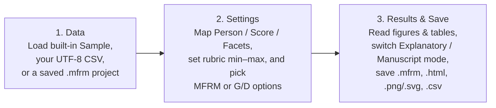

<p align="center">
  
</p>

<h1 align="center">MFRM — Fairer Rating Analysis, Visually Explained</h1>

<p align="center">
  <strong>Separate student proficiency from rater strictness, task difficulty, and rubric behavior on one shared scale.</strong><br />
  <a href="https://github.com/Ryuya-dot-com/MFRM_Python_Application/releases/tag/desktop-windows-20261030"><strong>Download Windows Preview</strong></a> ·
  <a href="docs/desktop_user_guide.en.md"><strong>Desktop Guide (Windows &amp; macOS)</strong></a> ·
  <a href="https://mfrmpythonapplication-xodghmcghngx8cz5zmhfeg.streamlit.app/"><strong>Open Web App</strong></a> ·
  <a href="docs/analysis_scope.md"><strong>Interpretation Guide</strong></a> ·
  <a href="README.ja.md"><strong>日本語</strong></a>
</p>

---

## Why Use MFRM? A Concrete Example

Imagine you are collecting essay, speaking, or clinical OSCE scores for a thesis or program evaluation on a **0–5 rubric**:

| Examinee | Assigned rater | Assigned prompt | Raw mean score | Who looks stronger from raw averages? |
|---|---|---|---|---|
| **Student A** | **Rater 4** *(strict)* | **Task 2** *(complex argumentative prompt)* | **3.2 / 5.0** | Looks weaker in Excel (`3.2`) |
| **Student B** | **Rater 1** *(lenient)* | **Task 1** *(familiar personal prompt)* | **3.6 / 5.0** | Looks stronger in Excel (`3.6`) |

Why can't raw averages—or even a high inter-rater correlation (`r = 0.90`)—solve this?

1. **Raw averages mix examinee skill with luck of the draw:** Student A was graded by a tougher rater on a harder prompt.
2. **Correlation ignores constant severity gaps:** Two raters can rank students in nearly the same order while one consistently scores a full point lower than the other.
3. **Rubric numbers are not automatically equal steps:** Moving from `1 → 2` on *Content* is rarely the same jump as moving from `4 → 5` on *Mechanics*.

**Many-Facet Rasch Measurement (MFRM)** estimates examinee proficiency, rater severity, task difficulty, and criterion difficulty together on a single **logit ruler** (`0.00` = average facet location), while **Generalizability / Decision (G/D) studies** show how changing the number of raters or tasks affects score reliability.

**MFRM Desktop** brings these workflows into one self-contained app (`Data → Settings → Results`)—with **no FACETS, ConQuest, R, or command-line setup required** in the packaged Windows preview.


> **Reading the built-in writing sample (`Data → Sample → Next → Analyze`) at a glance:**
> - **Left (`Persons · n = 30`):** Examinee locations span roughly `-2.4` to `+2.4` logits (higher = stronger performance).
> - **Right (`Rater`, `Task`, `Criterion`):** `R4` (`+0.47` logits) grades much more strictly than `R1` (`-0.73` logits—nearly a **1.2-logit** gap!); `Task2` (`+0.31`) is harder than `Task1` (`-0.31`); and earning high marks on `Mechanics` (`+0.28`) is harder than on `Content` (`-0.56`).
> - **Dotted horizontal lines:** Common rating-scale step thresholds across the 0–5 rubric. Because student locations and facet/step locations overlap vertically, the test is **well targeted** to this group.

---

## Choose How to Run MFRM

| Platform | Best for | Current availability & how to start |
|---|---|---|
| **Windows 11 (x64) Desktop** | Offline local analysis, `.mfrm` project files, manuscript PNG/SVG exports — **no Python install needed** | **Public preview available now.** [Download from GitHub Releases](https://github.com/Ryuya-dot-com/MFRM_Python_Application/releases/tag/desktop-windows-20261030) (application ZIP hosted on Dropbox) and follow the [Desktop Guide](docs/desktop_user_guide.en.md). Unsigned preview (`0.2.19-beta`); Windows on ARM and other Windows editions are not yet verified. |
| **macOS (Apple Silicon) Desktop** | Same native `Data → Settings → Results` desktop workflow on M1 or later Macs | **Runs from Python source today** via the [developer startup steps](CONTRIBUTING.md#run-from-source) and shares every workflow in the [Desktop Guide](docs/desktop_user_guide.en.md). A public standalone `.app` download is not yet released while platform acceptance continues. |
| **Web Browser (Any OS)** | Instant browser exploration, plus extra research modules (bounded GPCM, latent regression, anchors/linking, residual PCA, simulation) | **[Open the hosted Web app](https://mfrmpythonapplication-xodghmcghngx8cz5zmhfeg.streamlit.app/)** (`v0.2.19-beta`) with synthetic or appropriately de-identified data, or [install and run locally](#install) for confidential datasets. |
| **Contributors & Builders** | Running tests, checking build manifests, or packaging desktop prototypes | See [CONTRIBUTING.md](CONTRIBUTING.md) and [DEPLOYMENT.md](DEPLOYMENT.md). |

> [!NOTE]
> **Downloading the right file:** On GitHub Releases, GitHub's automatic **Source code (zip)** contains Python source code, not the standalone desktop app. For Windows, use **Download MFRM Desktop for Windows x64** at the top of the [`desktop-windows-20261030` release](https://github.com/Ryuya-dot-com/MFRM_Python_Application/releases/tag/desktop-windows-20261030) (the separate `v0.2.19-beta` tag is the Web/source release). In the Web app, check **About MFRM** for the live commit and version.

---

## Your First Analysis in 60 Seconds

MFRM Desktop guides you through three screens—**Data → Settings → Results**—with an instant **English / 日本語** selector in the top bar:



- **Desktop quick start:** Click **Data → Sample → Next → Analyze**. Explore **Figure** (`Wright map`, `Pathway map`, `Category probabilities`—click **Reading guide** next to any chart for plain-English help) and **Table**, then save a `.mfrm` project or `.html` report. Follow the **[Desktop User Guide (Windows & macOS)](docs/desktop_user_guide.en.md)** for a full walkthrough.
- **Browser quick start:** Open the [Web app](https://mfrmpythonapplication-xodghmcghngx8cz5zmhfeg.streamlit.app/), choose the sample tour or **Continue without the guide**, run **Built-in example → Writing essay**, read **First Read**, and export from **Report & Export**.

---

## What Results Look Like — and How to Interpret Them

Once an analysis finishes, here is how to connect what you see on screen to concrete assessment conclusions (and what **not** to overclaim in a thesis or manuscript):

| Output | If you see this pattern… | What it tells you in practice |
|---|---|---|
| **Wright map** | `Persons` (left) line up vertically with `Rater` / `Task` / `Criterion` points and dotted step lines (right) | **Good targeting:** tasks and rubric steps match the proficiency range of your examinees. If almost all persons sit far above or below the facets, the tasks were too easy (ceiling) or too hard (floor). |
| **Pathway map & Fit (`Infit MnSq`)** | A strict rater like `R4` (`+0.47` logits) sits near the vertical `Infit MnSq = 1.00` line (`Infit = 1.05`) | **Predictably strict vs. erratic:** Severity (vertical) is distinct from consistency (horizontal). Near `1.00` means consistent application of standards; far right (`> 1`, *underfit*) flags noisy, erratic ratings to inspect; far left (`< 1`, *overfit*) suggests muted/central-tendency scoring. Never drop a rater or examinee from a fit value alone. |
| **Category probability curves** | Each score (`0`, `1`, `2`, `3`, `4`, `5`) forms its own distinct hill from left to right | **Healthy rubric scale:** Raters use every category to distinguish ascending performance bands. If a middle curve stays flat or buried underneath neighbors, check **Observed Category Use** and rubric descriptors (or test **PCM** if criteria use steps differently). |
| **Conditional bias heatmap** | Most `Facet A × Facet B` cells stay near `0.00`, while one cell shifts noticeably (`+` or `−` logits) | **Exploratory diagnostic prompt:** Flags a rater-by-task or rater-by-criterion pairing to review during rater training, with main calibration held fixed. It does **not** prove statistically significant bias or unfairness. |
| **Specified intervals / Joint interaction** | Horizontal interval bars appear for eligible fixed-SD MML facet levels, `A − B` contrasts, or refitted interaction cells | **Scoped model-based uncertainty:** Shows pointwise approximate intervals where numerical checks pass (using full covariance for contrasts; Holm adjusts the recorded family of joint-interaction tests, not the intervals). Blank/withheld rows indicate unmet checks—never zero uncertainty. |
| **D-Study (`G` & `Phi` curves)** | Vertical jumps across `Task = 1..4` lines vs. the slope along `Rater count = 1..6` show how each design reaches higher `G` / `Phi` | **Actionable design trade-off:** Compare equal-effort designs (e.g., `2 tasks × 3 raters` vs. `1 task × 6 raters`) alongside the variance-component table to see whether more prompts or more raters reduce error faster (`G` = relative rank; `Phi` = absolute cutoff; intervals withheld). |

| Rubric Category Functioning (`RSM`) | Rater & Task Count Planning (`D Study`) |
|---|---|
|  |  |
| *Built-in writing sample (`0`–`5`): six ordered peaks show each rubric level becoming most likely in turn along the logit scale.* | *Synthetic `GD_ANOVA.mfrm` example: projects observed-score `G` (solid) and `Phi` (dashed) across 1–6 raters and 1–4 tasks.* |

---

<a id="model-scope"></a>

## Model Scope

MFRM Desktop integrates core Rasch calibration, rubric diagnostics, interaction checks, selected fixed-SD intervals, and balanced G/D design planning in one application:

| Research or operational task | Available workflow |
|---|---|
| **Estimate examinee measures & facet effects** | **RSM** (shared rubric steps) or **PCM** (facet-specific steps), with **JMLE** or **fixed-population-SD MML** (EM) |
| **Inspect scale targeting & fit** | Wright maps, Pathway maps (`Infit`, `Outfit`, `Approx. Infit ZSTD`), category probability curves, estimate & fit tables |
| **Examine combinations of facet levels** | Fixed-calibration **Conditional bias** diagnostics; Desktop also includes a separately refitted fixed-`N(0,1)` MML **Joint interaction** model |
| **Quantify selected facet uncertainty** | **Specified pointwise intervals** for numerically eligible fixed-SD MML facet levels and prespecified `A − B` differences |
| **Compare rater & task count designs** | Observed-score **G/D studies** for completely crossed, balanced 1- or 2-random-facet designs |
| **Save, restore & publish** | Web reports/downloads; Desktop `.mfrm` projects (reopened without refitting), offline `.html` reports, `.csv`, `.png` (300 DPI), and `.svg` |

The Web interface adds bounded GPCM, latent regression, anchors/linking, residual PCA, and simulation. Read [Analyses, interpretation and reporting limits](docs/analysis_scope.md) before using any output to support a statistical claim.

---

## Preparing Your Data (`CSV` Format)

Arrange ratings in **long format**—**one row per single rating event** (one examinee rated by one rater on one task and criterion):

```csv
Person,Rater,Task,Criterion,Score
P01,R1,T1,Content,4
P01,R1,T1,Organization,3
P01,R2,T1,Content,5
P02,R1,T1,Content,2
```

*(Practice with the full 960-row [synthetic writing CSV](examples/desktop_writing.csv) or click **CSV format → Save example CSV** inside the desktop app.)*

- **Three essentials:** (1) Use integer ratings for MFRM rather than averaged decimals, and reshape wide `Rater1, Rater2` columns into rows; (2) enter the rubric's **full intended minimum and maximum** (e.g., `0` and `5`) even if an extreme category was never observed; (3) **never enter `0` for an unrated cell**—leave missing scores blank or omit the row (`0` means an actual score of zero).
- **Supported formats:** Desktop reads **UTF-8 CSV**. Web also accepts spreadsheet paste, TSV/TXT, Excel, Parquet, and JSON. See [Use your own CSV](docs/desktop_user_guide.en.md#use-your-own-csv) for column mapping details.

---

## Statistical Caveats & Scope Boundaries

A completed run does not make every displayed number suitable for statistical inference. Always check the message attached to the specific table or figure:

- **General MML tables, Person-score uncertainty, estimated population-SD uncertainty, and automatic equivalence claims** remain restricted. JMLE `Conditional` bounds hold other fitted parameters fixed as screening approximations; fixed-SD MML **Specified structural intervals** apply only to their own numerically checked targets and do not guarantee finite-sample coverage or simultaneous intervals.
- **Conditional bias diagnostics** hold main calibration fixed and do **not** establish statistical significance, absence of bias, or fairness. **Joint interaction** refits a separate fixed-`N(0,1)` unit-weight model; Holm adjusts its recorded family of requested tests, not its intervals.
- **G/D studies** require complete, balanced 1- or 2-random-facet designs with >= 2 levels per factor, 1 observation per cell, and unit weights. Multivariate G-theory and `G`/`Phi` confidence intervals are not implemented.
- **Blank `SE` or interval cells mean unavailable, not zero.** Input/design problems (such as disconnected rating groups) can be corrected in data setup, whereas method-scope limits cannot be removed by rerunning the same analysis. See the [interpretation guide](docs/analysis_scope.md).

---

## Guided Reporting, Manuscript Figures & Data Privacy

- **Saving & reopening:** On Desktop, **Save project** (`.mfrm`) preserves input data, settings, and results for instant reopening via **Data → Open project** without re-estimation *(older basic projects open cleanly, while older schema-1 apps cannot read extended projects saved by this preview—keep original files when updating)*. **Save report** writes a standalone offline `.html` report. See [Save and reopen](docs/desktop_user_guide.en.md#save-and-reopen). On Web, use **Report & Export** ([manuscript guide](docs/apa_manuscript_template.md)).
- **Manuscript figures:** Desktop **Manuscript** mode moves overall titles and long explanatory notes out of the image into an accompanying **`.caption.txt`** file while keeping axes, legends, labels, and withheld-result notices intact. On the hosted Web app, use the offered interactive HTML figure download whenever host PNG export is unavailable.
- **Data privacy:** Ratings and `.mfrm` projects can contain examinee/rater IDs and sensitive responses. Run confidential analyses locally on a controlled machine under your institution's rules. Uploaded Web data run on remote servers, and analysis IDs/fingerprints verify provenance rather than encrypting or anonymizing data.

---

## Install

*(Skip this section if you are using the standalone [Windows Desktop Preview ZIP](https://github.com/Ryuya-dot-com/MFRM_Python_Application/releases/tag/desktop-windows-20261030), which bundles Python.)*

To run the Web app from source, use **Python 3.11 or 3.12** in a virtual environment:

```bash
git clone https://github.com/Ryuya-dot-com/MFRM_Python_Application.git
cd MFRM_Python_Application
python3 -m venv .venv
source .venv/bin/activate
python -m pip install -r requirements.txt
```

On Windows, create the environment with `py -3.12 -m venv .venv` and invoke `.venv\Scripts\python.exe` in place of `python` for installation and startup commands (activation is optional).

## Run

From the repository root with your virtual environment:

```bash
python -m streamlit run streamlit_app.py
```

For Desktop source startup on macOS or Windows, see [CONTRIBUTING.md — Run from source](CONTRIBUTING.md#run-from-source). For hosted deployment, see [DEPLOYMENT.md](DEPLOYMENT.md).

---

## License

[MIT License](LICENSE) · [License notice](LICENSE_NOTICE.md). Research, teaching, and commercial use are permitted; retain copyright and license notices when redistributing (third-party components keep their own licenses). Provided without warranty—users remain responsible for data handling, model assumptions, and substantive interpretation.

## Citing this software

Cite the exact version and source commit used ([`CITATION.cff`](CITATION.cff) powers GitHub's citation menu, and the Web app provides BibTeX/CFF downloads under **About MFRM**):

> Komuro, R. (2026). *MFRM Streamlit* (Version 0.2.19-beta) [Computer software]. https://github.com/Ryuya-dot-com/MFRM_Python_Application

For the Windows desktop preview, also record the release tag (`desktop-windows-20261030`) and archive name. Cite the statistical methods separately alongside the software; citation is appreciated and not an additional MIT license condition.

## Help and contributions

Report questions or bugs in [GitHub Issues](https://github.com/Ryuya-dot-com/MFRM_Python_Application/issues) with your OS, version/archive name, steps, and exact message (removing identifiable data first). Contribution and build instructions are in [CONTRIBUTING.md](CONTRIBUTING.md).
