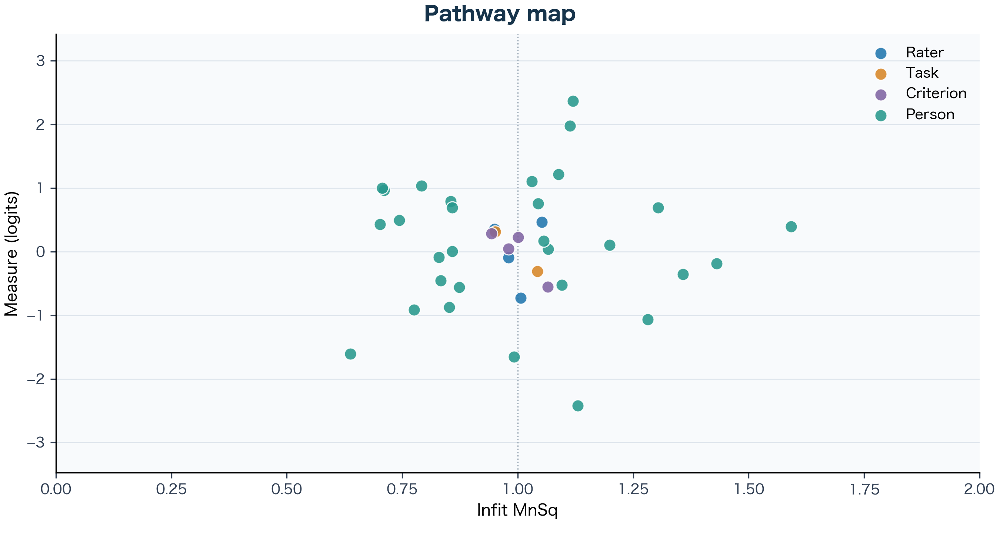
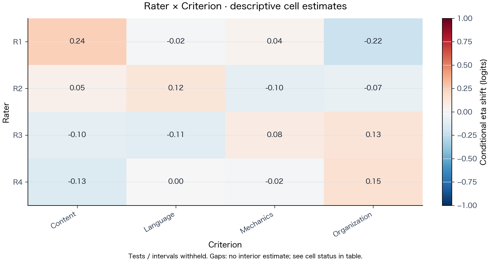

<p align="center">
  
</p>

<h1 align="center">MFRM Desktop User Guide — Windows &amp; macOS</h1>

<p align="center">
  <a href="desktop_user_guide.ja.md"><strong>日本語ガイド</strong></a> ·
  <a href="../README.md"><strong>Project Overview</strong></a> ·
  <a href="#why-mfrm"><strong>Why MFRM?</strong></a> ·
  <a href="#get-and-open-the-app"><strong>Get &amp; Open</strong></a> ·
  <a href="#try-the-sample"><strong>Sample Walkthrough</strong></a> ·
  <a href="#use-your-own-csv"><strong>Prepare Your CSV</strong></a> ·
  <a href="#choose-an-analysis"><strong>Choose an Analysis</strong></a> ·
  <a href="#read-the-results"><strong>Interpret Every Plot</strong></a> ·
  <a href="#save-and-reopen"><strong>Save &amp; Reopen</strong></a> ·
  <a href="#troubleshooting"><strong>Troubleshooting</strong></a>
</p>

---

<a id="why-mfrm"></a>

## Why Use MFRM? Start with a Concrete Example

Suppose you are analyzing university essay ratings (or L2 speaking interviews, music juries, or clinical OSCE stations) for a thesis or departmental assessment. Four trained raters (`R1`–`R4`) score 30 students across two writing prompts (`Task1`, `Task2`) and four rubric criteria (`Content`, `Organization`, `Language`, `Mechanics`) on a **0–5 scale**.

In realistic testing programs, you rarely want to rely on raw score averages alone:

- **The "severe rater / hard prompt" trap:** Suppose **Student A** writes `Task2` (*an abstract policy argument*) and is graded by **`R4`** *(the most severe rater)*, earning a raw average of **3.2 / 5.0**. **Student B** writes `Task1` (*a familiar personal topic*) for **`R1`** *(the most lenient rater)* and averages **3.6 / 5.0**. Raw averages make Student B look stronger—even if Student A actually demonstrated higher ability under tougher conditions.
- **Why correlation or Kappa isn't enough:** Even if `R1` and `R4` correlate at `r = 0.90`, `R4` might consistently award scores one point lower than `R1`. High rank-order agreement does not remove a constant severity gap.
- **Why rubric steps need checking:** Writing `"0 = Emerging … 5 = Exemplary"` on a rubric sheet does not guarantee raters actually use all six categories cleanly or treat *Content* and *Mechanics* with equal severity.

### What MFRM & G/D Studies Give You Instead

1. **One shared "logit" ruler (`MFRM`):** MFRM converts ordinal rubric scores into a common log-odds (**logit**) scale centered at `0.00` for non-person facets:
   - **Examinees (`Person`):** Higher logits = **higher ability** (adjusted for the raters, tasks, and criteria involved).
   - **Raters (`Rater`):** Higher logits = **greater severity**; lower (negative) logits = **greater leniency**.
   - **Tasks & Criteria (`Task`, `Criterion`):** Higher logits = **harder to earn high scores on**; lower logits = **easier**.
2. **Quality diagnostics (`Fit`, `Category Curves`, `Bias`):** Checks whether a severe rater is *predictably* severe (`Infit MnSq ≈ 1.00`) vs. erratic (`Infit >> 1.00`), whether every rubric score (`0`–`5`) has its own clear zone, and whether specific pairs (like `R1 × Content`) behave unusually.
3. **Practical assessment design (`G/D Study`):** Uses observed scores to show how reliability (`G` for relative ranking, `Phi` for pass/fail cutoffs) changes if you assign **2 vs. 3 raters** or **2 vs. 4 tasks**.

All of these run offline in one three-step desktop window (**Data → Settings → Results**), with an instant **English / 日本語** switch in the top bar.

---

<a id="get-and-open-the-app"></a>

## 1. Get and Open the App

### Windows 11 (x64) — Standalone Preview ZIP (Available Now)

Python is bundled inside the download—no Python, R, FACETS, or ConQuest installation is needed.

1. Open the **[Windows Desktop Preview Release (`desktop-windows-20261030`)](https://github.com/Ryuya-dot-com/MFRM_Python_Application/releases/tag/desktop-windows-20261030)** and click **Download MFRM Desktop for Windows x64** (hosted on Dropbox, with SHA-256 checksums listed on the release page).
   - *Tip:* GitHub's automatic **Source code (zip)** at the bottom of the page is source code, not the Windows app, and the separate `v0.2.19-beta` tag is the Web/source release.
   - Optionally download the **Synthetic Examples ZIP** (`PCM_MML.mfrm` and `GD_ANOVA.mfrm`) from the same release page to explore saved extended projects immediately.
2. In File Explorer, right-click the downloaded ZIP and select **Extract All**. Keep **`MFRM-Desktop.exe`** and the entire **`_internal`** folder together in the same folder (never run the EXE from inside the unextracted ZIP or move the EXE alone).
3. Double-click **`MFRM-Desktop.exe`**.

> [!IMPORTANT]
> **Unsigned Windows preview:** Because this preview executable (`0.2.19-beta`) is unsigned, Windows may display a security prompt on first launch. If opening is blocked, record the exact message for support—**do not disable Windows protection**. Windows on ARM and other Windows versions are not verified, and this preview is not yet certified across every Windows configuration.

### macOS (Apple Silicon, M1 or Later) — Standalone Preview ZIP (Available Now)

MFRM Desktop uses the identical `Data → Settings → Results` interface on Apple Silicon Macs (`arm64`; Python is bundled inside `MFRM-Desktop.app`, while Intel Macs can run from [Python source](../CONTRIBUTING.md#run-from-source)):

1. Open the **[macOS Desktop Preview Release (`desktop-macos-20261030`)](https://github.com/Ryuya-dot-com/MFRM_Python_Application/releases/tag/desktop-macos-20261030)**, download `MFRM-Desktop-macOS-arm64-preview-dabb891-20261030.zip`, and verify its SHA-256 in Terminal with `shasum -a 256` before opening (GitHub's automatic **Source code (zip)** at the bottom is source code, not the app).
2. Double-click the ZIP in Finder to expand it. Keep the complete **`MFRM-Desktop.app`** bundle intact in a writable folder such as your user `Applications` folder.
3. Open **`MFRM-Desktop.app`**.

> [!IMPORTANT]
> **Unnotarized macOS preview:** Because this preview bundle (`0.2.19-beta`, bundled libraries targeting macOS 14.0+) carries an ad-hoc signature without Apple Developer ID notarization, macOS displays an unidentified-developer prompt on first launch. Only after verifying the source and SHA-256, follow [Apple's official Open Anyway guidance](https://support.apple.com/en-us/102445) (**System Settings → Privacy & Security → Open Anyway**) if your Mac permits it—**do not disable Gatekeeper or strip quarantine attributes**, and investigate rather than override any damaged-app warning.

### Want to try in a browser first?

Open the **[Web App](https://mfrmpythonapplication-xodghmcghngx8cz5zmhfeg.streamlit.app/)** with synthetic or properly de-identified data. On Desktop, analysis and saving stay completely local offline; only **Help → Web theory and help** uses the internet to open documentation (without uploading your desktop data).

---

<a id="try-the-sample"></a>

## 2. Try the Sample — Walkthrough with Actual Numbers

Let's run the built-in synthetic essay dataset (**30 examinees × 4 raters × 2 tasks × 4 criteria = 960 ratings**) and read the exact numbers that appear on screen:

1. In **Data**, click **Sample** (`Writing sample (synthetic data)`), inspect the 10-row preview, and click **Next**.
2. In **Settings → Columns / rubric**, confirm the pre-filled values (`Person` = `Person`, `Score` = `Score`, Facets = `Rater`, `Task`, `Criterion`, Minimum / Maximum = `0` / `5`). Leave **Model / estimation** on the defaults (`RSM` and `JMLE`).
3. Click **Analyze** (and confirm the 960-row prompt). Within seconds, **Results** opens.

### Check what you just discovered in `Table → Measures and Fit`

Switch to **Table** and look at the non-person rows of **Measures and Fit**:

| Facet | Level | Estimate (logits) | `Infit MnSq` | Plain-language takeaway from this sample |
|---|---|---:|---:|---|
| `Rater` | `R1` | **`-0.726`** | `1.006` | Most lenient rater (`0.73` logits below the rater mean), and very consistent (`Infit ≈ 1.01`). |
| `Rater` | `R2` | **`-0.093`** | `0.980` | Close to average severity, consistent fit. |
| `Rater` | `R3` | **`+0.352`** | `0.950` | Moderately severe, consistent fit. |
| `Rater` | `R4` | **`+0.467`** | `1.052` | Most severe rater—**`1.19` logits more severe than `R1`**, yet still consistent (`Infit ≈ 1.05`)! |
| `Task` | `Task1` / `Task2` | **`-0.311` / `+0.311`** | `1.043` / `0.951` | `Task2` is `0.62` logits harder than `Task1`. |
| `Criterion` | `Content` → `Mechanics` | **`-0.556` → `+0.283`** | `1.065` → `0.943` | Raters award high marks most readily on `Content` (`-0.56`) and score `Mechanics` (`+0.28`) and `Language` (`+0.23`) more severely. |

*(Note: In JMLE, the table's `Conditional` `SE / SD` and bounds hold other fitted parameters fixed as screening approximations—always read the note directly below each table!)*

Now switch to **Observed Category Use**: all six rubric categories (`0` through `5`) are well populated—from `72` ratings (`7.5%`) at score `0` and `96` (`10.0%`) at score `5` up to `230` (`24.0%`) at score `2` and `225` (`23.4%`) at score `3`. Finally, try **Save project** (`.mfrm`) and **Save report** (`.html`).

---

<a id="use-your-own-csv"></a>

## 3. Prepare and Import Your Own CSV

### Reshape wide spreadsheets into "one row = one rating"

Spreadsheets exported from gradebooks often put raters side by side (*wide format*). Before importing into MFRM Desktop, stack them so **every row is one single rating event**:

```text
❌ Wide format (do NOT import directly):
Student, Task, Criterion, Rater1_Score, Rater2_Score
E01,     T1,   Content,   4,            5

✅ Long format (ready for MFRM Desktop):
Person,Rater,Task,Criterion,Score
E01,R1,T1,Content,4
E01,R2,T1,Content,5
```

*(Click **CSV format → Save example CSV** in the app or inspect [`examples/desktop_writing.csv`](../examples/desktop_writing.csv) for a complete template.)*

### Four data-checks before clicking `Analyze`

1. **Save as UTF-8 CSV:** In Excel, pick **CSV UTF-8 (Comma delimited) (`*.csv`)**. Japanese and accented column/level names are supported; leading zeros in IDs (like `007`) are kept intact.
2. **Use individual integer ratings, not averages:** MFRM models discrete rubric categories (`0, 1, 2, 3, 4, 5`). Fractional scores (like `3.5`) will stop validation with an explanation. Every row receives equal (unit) weight.
3. **Enter the full rubric range—and never code "missing" as `0`:** On a 0–5 rubric, type `0` and `5` in **Settings** even if nobody scored `0`. If a rater skipped an essay, omit that row or leave `Score` blank (`0` means an earned score of zero!).
4. **Make sure raters and tasks overlap ("connectedness"):** If Raters A & B *only* grade Group 1 and Raters C & D *only* grade Group 2 with zero shared students or tasks, no statistical model can tell whether Group 1 is stronger or Raters A & B are simply more lenient! Design rating assignments with shared examinees/tasks across raters.

---

<a id="choose-an-analysis"></a>

## 4. Choose the Right Analysis for Your Research Question

In **Settings**, select **MFRM** (tabs: **Columns / rubric**, **Model / estimation**, **Bias / intervals**, **G/D plan**) or standalone **G/D Study**:

| Your research or practical question | What to select in `Settings` | How it works & what conditions apply |
|---|---|---|
| **Do all tasks and criteria share the same 0–5 rubric structure?** | `MFRM` → **Model: `RSM`** *(Rating Scale Model)* | Estimates one shared set of step thresholds across the whole rubric. Great starting point when every criterion uses the same 0–5 descriptors. |
| **Do different criteria or tasks have different step spacing (or different score ranges)?** | `MFRM` → **Model: `PCM`** *(Partial Credit Model)* + choose **PCM step facet** | Lets each level of the chosen facet (e.g., `Criterion`) have its own step thresholds—useful when jumping from `4 → 5` is much steeper in *Mechanics* than in *Content*. |
| **Should I pick `JMLE` or `MML`?** | `MFRM` → **Estimation method: `JMLE`** or **`MML`** | **JMLE** jointly estimates individual person and facet parameters (with screening safeguards when a free level has only min or max scores). **MML** treats persons as drawn from a normal distribution with a user-set **MML fixed population SD** (estimated via EM) and is required if you want **Specified intervals** or **Joint interaction**. |
| **Does a specific rater grade a specific task/criterion unusually harshly or leniently?** | `MFRM` → **Bias / intervals** → **Bias (registered requests)** → pick `Facet A`, `Facet B` → click **`Add`** | Computes descriptive cell shifts holding the main calibration fixed. Ideal for spotting rater-training topics; does **not** prove statistical significance or fairness. |
| **What is the confidence interval for Rater 4's severity, or for `R4 − R1`?** | `MFRM` (`MML`) → **Bias / intervals** → **Specified intervals** → pick facet / `A − B` → click **`Add`** | Computes pointwise asymptotic normal intervals using full structural covariance **only** for targets that pass stopping, identification, boundary, information, and quadrature checks. |
| **What happens if we refit the model with `Facet A × Facet B` estimated jointly alongside main effects?** | `MFRM` (`MML`, **fixed SD = `1`**) → **Bias / intervals** → **Joint interaction** → check **`Add to next analysis`** | Fits a separate fixed-`N(0,1)` RSM/PCM interaction model. Reports pointwise approximate Wald intervals & p-values for eligible cells/contrasts, plus Holm-adjusted p-values across the recorded family of requested tests (intervals remain pointwise, not simultaneous). |
| **Would 3 raters × 2 tasks or 2 raters × 3 tasks give higher score reliability?** | Top selector: **`G/D Study`** *(or check **`Add G/D to MFRM`** in **G/D plan**)* | Runs balanced crossed ANOVA on original observed scores (no MFRM fit needed in standalone mode). Requires **completely crossed, balanced** data with **1 or 2 random facets**, >= 2 levels per factor, 1 observation per cell, and unit weights. |

> [!WARNING]
> **Remember to click `Add`!** In **Bias (registered requests)** and **Specified intervals**, picking facet names in the dropdowns does not register them until you click **Add** and see the request listed in the box.

---

<a id="read-the-results"></a>

## 5. Interpret Every Plot — What Patterns Mean in Practice

Here is how to read each visual output in **Results**, including both **healthy patterns** and **warning signs** you might encounter in your own thesis or assessment data:

### 5.1 Wright Map — Scale Targeting & Facet Spread


| What you observe on the Wright map | How to interpret it | Practical next step |
|---|---|---|
| **Person bars (left) overlap well vertically with facet points & dotted step lines (right)** | Tasks and rubric categories are well matched ("targeted") to your examinees' ability range. | Proceed to inspect individual facet spreads and fit in **Pathway map** and **Table**. |
| **Persons cluster near `+3` logits while tasks/steps sit near `0` (or vice versa)** | **Ceiling or floor effect:** Tasks/rubric were too easy or too hard for this cohort, making extreme examinees harder to separate precisely. | Check **Observed Category Use** for bunching at the top/bottom score and check extreme-score notes in **Measures and Fit**. |
| **Wide vertical gap among raters (e.g., `R4 = +0.47` vs. `R1 = -0.73`)** | Raters differ substantially in overall severity—raw unadjusted averages would disadvantage students rated only by `R4`. | Check **Pathway map** next: if `R4` sits near `Infit = 1.0`, MFRM's main-effect adjustment accounts for `R4`'s consistent severity. |

---

### 5.2 Pathway Map — Separating Severity from Consistency (`Infit MnSq`)



One of the most useful ideas in Rasch measurement for graduate research is that **vertical position (severity/difficulty)** and **horizontal position (`Infit MnSq` consistency)** ask two completely different questions:

| Horizontal region (`Infit MnSq`) | Meaning in everyday assessment terms | How to handle it in your study |
|---|---|---|
| **Near `1.00` (dotted reference line)** | **Model-consistent variation:** A severe rater near `1.00` grades toughly *in a predictable way*; a lenient rater near `1.00` grades generously *in a predictable way*. | Main-effect logit estimates meaningfully summarize their overall severity or difficulty. |
| **Far to the right (`> 1.0`, *underfit / noisy*, e.g., `1.4`–`2.0+`)** | **Unexpected/erratic ratings:** For a rater, occasional harsh marks on strong performances or generous marks on weak ones; for an examinee (like `E14` at `Infit = 1.59`), unusually uneven scores across criteria or raters. | **Do not automatically delete raters or students from one number.** Check rating counts first, inspect original ratings, and review rubric wording or rater calibration notes. |
| **Far to the left (`< 1.0`, *overfit / muted*, e.g., `0.5`–`0.7`)** | **Less variation than expected:** Often reflects *central tendency* (clinging to safe middle scores like `2` and `3`) or *halo effects* (giving identical marks across all four criteria). | Inspect **Observed Category Use** and rater score distributions to see whether middle bands are overused. |

---

### 5.3 Category Probability Curves — Is Your Rubric Working?


| Curve pattern | What it tells you about the rubric | Recommended check |
|---|---|---|
| **Each score (`0`–`5`) rises to its own distinct peak in order from left to right** | Every rubric category represents a genuine, ordered performance zone as examinee ability rises relative to task/rater difficulty. | Confirm adequate counts per category in **Table → Observed Category Use**. |
| **A middle curve is squashed beneath neighboring curves or thresholds cross** | Raters are not distinguishing that score band cleanly from adjacent bands, or very few observations fell in that category. | Check **Observed Category Use** (sparse counts make step estimates unstable), review rubric descriptors, or test **PCM** if only one criterion has collapsed categories. |

---

### 5.4 Conditional Bias Heatmap vs. Specified Intervals & Joint Interaction



- **Reading the Conditional Bias Heatmap (`Rater × Criterion` above):**
  - Numbers near **`0.00`** mean that pairing behaves just as expected from the rater's overall severity plus the criterion's overall difficulty.
  - Non-zero shifts (e.g., `R1 × Content = +0.24` vs. `R1 × Organization = -0.22`) describe how that cell's observed scores deviate when main calibration is held fixed; gray cells mark pairs without an interior estimate (always check cell counts and status in the table!).
  - **Thesis writing caution:** Conditional bias heatmaps are **exploratory screening maps, NOT statistical proof of bias or fairness** (`Tests / intervals withheld`). Write *"Cell `R1 × Content` showed a descriptive shift of +0.24 logits with main calibration fixed, prompting qualitative review of rubric exemplars"*—not *"Rater 1 was significantly biased."*
- **When you need model-based uncertainty intervals:**
  - Use **Specified intervals** (fixed-SD MML) for a structural facet's levels or a prespecified `A − B` contrast, or **Joint interaction** (fixed-`N(0,1)` MML) to refit main effects, steps, and one interaction together.
  - If a target passes numerical checks, pointwise approximate intervals are plotted; if withheld (blank in table or reason shown on chart), **report it as unavailable rather than zero**—and remember numerical screens do not guarantee finite-sample coverage or simultaneous intervals.

---

### 5.5 D-Study Curves — Planning Rater and Task Counts (`G` and `Phi`)


| What to compare on the D-Study chart | Practical interpretation | Example from `GD_ANOVA.mfrm` above |
|---|---|---|
| **Solid lines (`G`) vs. dashed lines (`Phi`)** | **`G`** (generalizability) applies to **relative rank-order decisions** (e.g., ranking candidates); **`Phi`** (dependability) applies to **absolute cut-score decisions** (e.g., passing at `>= 70%`, where overall rater/task severity or difficulty shifts also count as error, so `Phi <= G`). | Pick `G` or `Phi` based on how scores will actually be used, and check signed + zero-clipped variance components in the table. |
| **Gap between `Task = 1, 2, 3, 4` lines vs. slope along `Rater count = 1..6`** | Compare combinations with the same rating budget (e.g., 6 ratings per person) and check the variance-component table: when *person × task* variance is large, higher-task curves pull well above `Task = 1`; when residual (*person × rater × task*) variance dominates, total `raters × tasks` drives the gain. | Moving from `1 task × 4 raters` (`G ≈ 0.31`) to `3 tasks × 4 raters` (`★ Selected plan`, `G ≈ 0.57`) or `4 tasks × 4 raters` (`G ≈ 0.64`) substantially boosts reliability, while 6-rating options (`1×6`, `2×3`, `3×2`) cluster near `G ≈ 0.40` because residual variance dominates in this synthetic example. |

*(Reminder: G/D requires complete, balanced 1–2 random-facet observed-score designs with 1 observation per cell and unit weights; `G` and `Phi` are point projections without confidence intervals, and benchmarks like `0.80` depend on assessment stakes rather than acting as universal rules. See [Analyses, interpretation and reporting limits](analysis_scope.md) for full details.)*

---

<a id="save-and-reopen"></a>

## 6. Save, Export Manuscript Figures, and Reopen Projects

| Goal | Action & format | Key detail |
|---|---|---|
| **Resume work later without recalculating** | **Save project** → `.mfrm` | Bundles input data, identifiers, settings, and results; reopen via **Data → Open project** with zero re-estimation. |
| **Read or share all tables & plots offline** | **Save report** → `.html` | Opens in any web browser with embedded vector figures and full methodological notes. |
| **Place clean figures in a thesis or journal paper** | **Save figure…** → `.png` (300 DPI) or `.svg` | Switch **Figure presentation** to **Manuscript** to move titles and long notes into an accompanying **`.caption.txt`** file. |
| **Analyze tables in Excel, R, or Python** | **Save CSV…** → `.csv` | Exports the selected table together with its qualification and interpretation notes. |

### Using `Manuscript` Figure Mode Properly

- **Explanatory (default):** Keeps the figure title and caution footer inside the image so slides and working notes stay self-contained.
- **Manuscript:** Moves the overall title and long caution prose outside the graphic while retaining axis labels, legends, data labels, and any withheld-output notice. Use **Title and note** to copy the text, and **always carry the saved `.caption.txt` content into your thesis or manuscript figure note** so statistical conditions are never lost. *(Check your target journal's or APA's specific layout guidelines.)*

### Safe Project Reopening & Version Updates

- Open saved `.mfrm` projects through **Data → Open project** (one project at a time; portable Windows builds do not register `.mfrm` file associations in Windows). Images and HTML reports cannot restore an interactive session.
- Editing controls in **Settings** does not overwrite displayed results—a notice reminds you that shown outputs belong to the previous analysis until you click **Analyze**.
- **Backups across versions:** This version reads older basic `.mfrm` projects without altering them, whereas older applications cannot open extended (schema 2) projects saved by this version, and reopened interval records check matching source/runtime conditions. Keep untouched copies of your previous app folder and original `.mfrm` files before testing a new build in a separate folder. Review `.mfrm` files and reports for student/rater IDs before sharing.

---

<a id="troubleshooting"></a>

## 7. Troubleshooting

| Situation | What to check & do |
|---|---|
| **`MFRM-Desktop.exe` will not open on Windows** | Confirm you ran **Extract All**, kept `MFRM-Desktop.exe` next to `_internal`, and are on **Windows 11 x64**. If Windows blocks the unsigned preview, record the exact message rather than disabling security protections. |
| **macOS blocks an unnotarized `.app` bundle** | Run from Python source ([instructions](../CONTRIBUTING.md#run-from-source)), or—only after verifying source and SHA-256 on a Mac that permits it—follow Apple's [Open Anyway guidance](https://support.apple.com/en-us/102445) without disabling Gatekeeper. |
| **CSV fails to import or non-English text is garbled** | Re-save from Excel as **CSV UTF-8 (Comma delimited)** and verify unique, non-empty column headers in row 1. |
| **`Analyze` keeps you on `Settings`** | Follow the validation message: check for overlapping column roles, decimal/out-of-range scores, or `Rubric maximum <= minimum`. |
| **Fewer rows were analyzed than expected** | Review the pre-run message for rows excluded due to blank/non-numeric scores or missing IDs, and check duplicate facet combinations. |
| **A bias heatmap or interval plot is missing in `Results`** | In **Settings → Bias / intervals**, click **Add** so the request appears in the list (or check **Add to next analysis** with `MML` and fixed SD `1` for Joint interaction), then click **Analyze**. |
| **A `Specified interval` is withheld due to data or numerical checks** | Read the table's `Reason` column: disconnected rating groups, extreme all-min/all-max scores, stopping tolerance, or quadrature resolution (`MML quadrature points`) can withhold intervals. A point estimate alone does not establish a significant difference. |
| **An `SE` or interval is blank for a whole table/method** | Blank means **unavailable**, never zero uncertainty. General MML tables, person-score uncertainty, and G/D intervals are restricted by current method scope—rerunning the same data will not unlock them. Check [analysis_scope.md](analysis_scope.md) for supported alternatives. |
| **Changing settings did not update the displayed chart** | Save any output you need from the previous run, verify the new settings, and click **Analyze**. |
| **You need to stop a running fit** | Click **Cancel**; any prior completed result in your session is preserved. |

For questions or bug reports, open an issue at **[GitHub Issues](https://github.com/Ryuya-dot-com/MFRM_Python_Application/issues)** with your OS, app version (`0.2.19-beta`), archive name, steps, and exact message—removing identifiable rating data before attaching files or screenshots.
